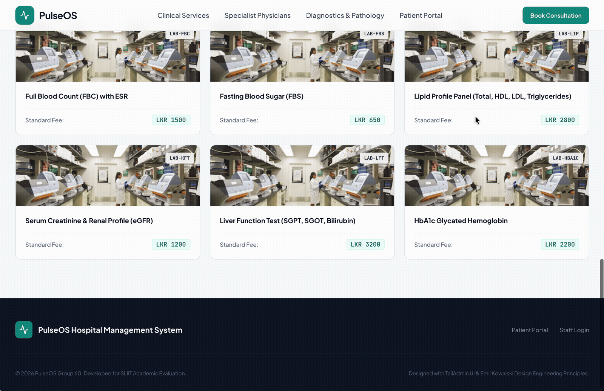
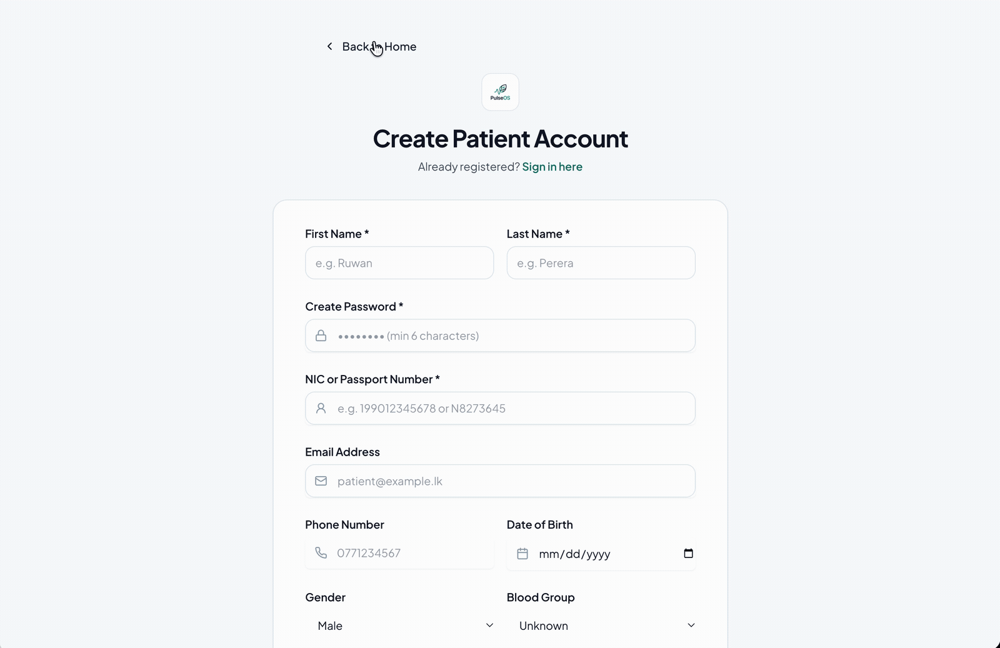
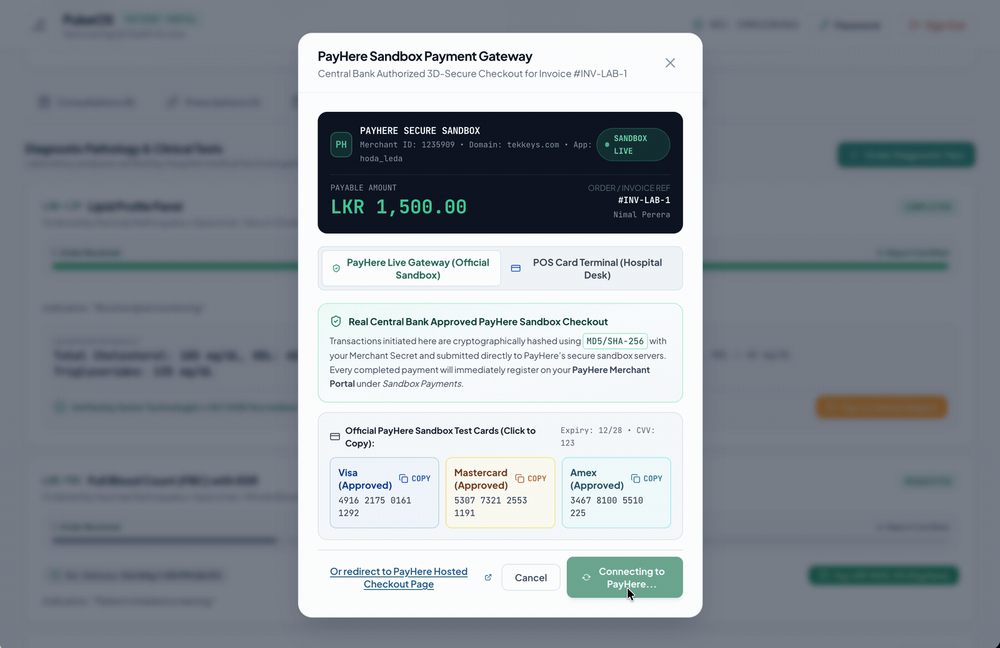
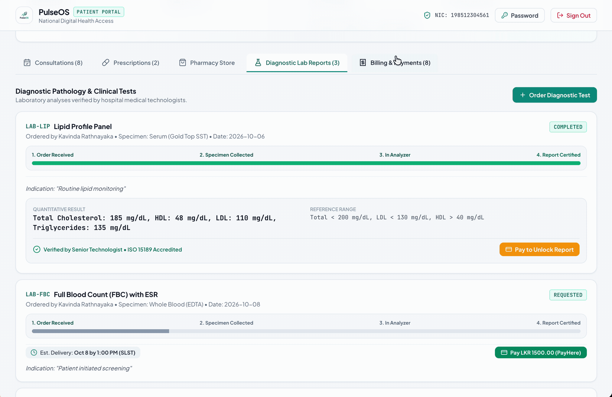
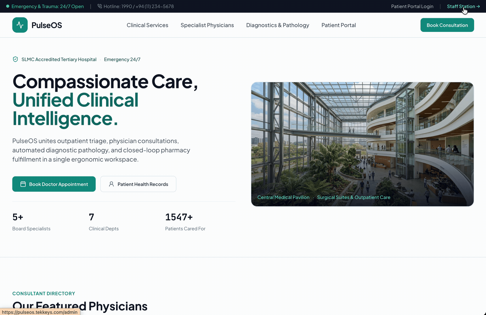
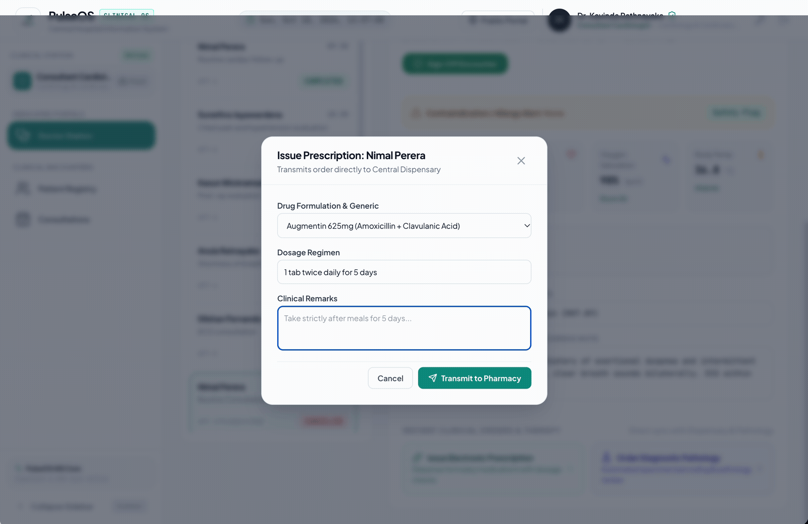

# PulseOS — Modern Hospital Management & Clinical EHR System

[](https://pulseos.tekkeys.com)
[](https://github.com/kesaruhasun/pulseos)
[](https://kesaru.me)
[](LICENSE)

**PulseOS** is an enterprise-grade, full-stack Hospital Management System (HMS) and Electronic Health Records (EHR) platform engineered to streamline clinical operations, outpatient consultations, diagnostic pathology laboratory workflows, pharmacy dispensary inventory, automated patient notifications, and billing. Designed with role-based access control (RBAC) across five specialized staff workflows and an intuitive self-service patient portal, PulseOS delivers end-to-end digital continuity from appointment booking and PayHere sandbox payment gateway checkout to electronic prescription dispatch and lab report generation.

---

## 🌟 Key Features by Role

### 🏥 Patient Portal
- **Self-Service Onboarding & Demo Access**: One-click quick login for rapid evaluation and authenticated profile management.
- **Outpatient Consultation Booking**: Real-time doctor directory, specialty filtering, and calendar slot reservations.
- **Integrated Payment Gateway Sandbox**: Automated invoice generation with instant card payment simulation (PayHere gateway).
- **Diagnostic Laboratory Archive**: Direct access to verified pathology reports, reference ranges, and test histories.
- **E-Prescription & Pharmacy History**: Track active medications, dosage instructions, and dispense statuses.
- **Multi-Channel Patient Alerts**: Automated consultation confirmations and lab results delivered via Email with WhatsApp / SMS integration capability.

### 🩺 Doctor (OPD & Clinical Care)
- **Clinical OPD Queue**: Live list of scheduled outpatient consultations with patient vitals and triage notes.
- **Digital Prescription Dispatch**: Searchable drug catalog with generic formulation lookup and direct digital dispatch to the hospital pharmacy.
- **Diagnostic Order Entry**: Prescribe laboratory investigations with clinical indications directly to the pathology lab.
- **Patient Medical History**: Longitudinal consultation summaries, previous diagnoses, and allergy warnings.

### 💊 Pharmacy Dispensary & Inventory
- **Real-Time Prescription Queue**: Immediate receipt of doctor-issued prescriptions with patient identification and dosage details.
- **Stock & Inventory Control**: Unit tracking, reorder alert thresholds, and automated stock deduction upon medication dispense.
- **Dispense Verification**: Cross-check prescription details, batch validity, and invoice synchronization.

### 🔬 Diagnostic Laboratory
- **Pathology Order Worklist**: Centralized tracking of doctor-ordered diagnostic tests (Hematology, Biochemistry, Imaging).
- **Results Entry & Verification**: Structured lab report data entry with abnormal flag indicators and automated PDF delivery to patient records.
- **Catalog & Pricing Management**: Public test catalog and tiered pricing definitions.

### 🛡️ Administrative & Financial Operations
- **Role-Based Access Control (RBAC)**: Secure multi-tier authentication for Admin, Doctor, Pharmacist, Receptionist, and Lab Tech roles.
- **Financial Analytics & Revenue Tracking**: Comprehensive billing ledger, payment audit trails, and outstanding invoice tracking.
- **Staff & Clinical Resource Scheduling**: Doctor roster assignment, specialty cataloging, and room allocations.

---

## 📸 Screenshots

| Feature | Preview |
| :--- | :--- |
| **Public Landing & Lab Catalog**<br>Diagnostic test discovery, pricing transparency, and doctor specialty directory. |  |
| **Patient Authentication & Quick Access**<br>Secure digital health login with one-tap demo credential switching. |  |
| **Consultation Booking & Payment**<br>Specialist physician scheduling with automated invoice generation and PayHere checkout. |  |
| **Diagnostic Lab Reports & Invoices**<br>Patient medical records repository for verified lab results and billing receipts. |  |
| **Enterprise Staff Portal**<br>Multi-role staff gateway with instant switching across administrative and clinical workflows. |  |
| **Doctor OPD & Prescription Dispatch**<br>Clinical OPD workstation for issuing e-prescriptions routed directly to the dispensary. |  |

---

## 💻 Tech Stack

### Frontend
- **Framework**: [React 19](https://react.dev) (`react` `^19.0.0`, `react-dom` `^19.0.0`)
- **Build System**: [Vite 6](https://vitejs.dev) (`vite` `^6.1.0`)
- **Language**: [TypeScript](https://www.typescriptlang.org) (`~5.7.2`)
- **Routing**: [React Router DOM](https://reactrouter.com) (`^7.18.3`)
- **Styling**: [Tailwind CSS](https://tailwindcss.com) (`^3.4.17`), PostCSS, Autoprefixer
- **Icons**: [Lucide React](https://lucide.dev) (`^0.475.0`)
- **HTTP Client**: [Axios](https://axios-http.com) (`^1.7.9`)
- **Date Utilities**: [date-fns](https://date-fns.org) (`^4.4.0`)

### Backend
- **Framework**: [Spring Boot 3.2.12](https://spring.io/projects/spring-boot)
- **Language & Runtime**: [Java 17](https://openjdk.org/projects/jdk/17/)
- **Security**: Spring Security 6 with stateless JWT authentication ([JJWT 0.12.5](https://github.com/jwtk/jjwt)) & BCrypt password hashing
- **Persistence & ORM**: Spring Data JPA with Hibernate
- **Databases**: 
  - [MySQL Connector/J](https://dev.mysql.com/doc/connector-j/en/) (Production)
  - [H2 Database](https://www.h2database.com) (Embedded local development & testing)
- **Validation**: Jakarta Validation / Hibernate Validator
- **Notification Services**: Spring Mail (`spring-boot-starter-mail`) for SMTP email dispatch, designed for WhatsApp Business API / Twilio SMS notification extensibility
- **Boilerplate Reduction**: Project Lombok

---

## 👥 Engineering Team & Contributors

PulseOS was designed and engineered as a collaborative full-stack healthcare platform:

- **[Kesaru Dhanasinghe](https://kesaru.me)** — *Project Lead • Core Architecture • Billing & Payments • PayHere Gateway Integration*
- **Dilshan Somarathna** — *Patient Management • Medical Records & Intake Demographics*
- **Kavinda Rathnayaka** — *Doctor Management • OPD Clinical Queue & Specialty Rostering*
- **Chanul Malwatta** — *Appointment Management • Consultation Scheduling & Conflict Prevention*
- **Harshika Udumullage** — *Pharmacy Dispensary & Medical Inventory Control*
- **Nethuli Thilakarathne** — *Laboratory Diagnostic Investigations & Pathology Reporting*

---

## 🚀 Getting Started

### Prerequisites
- Node.js (v20+ recommended)
- Java Development Kit (JDK 17)
- Maven 3.8+
- MySQL 8.0+ (Optional; H2 embedded mode runs out of the box)

### 1. Clone the Repository
```bash
git clone https://github.com/kesaruhasun/pulseos.git
cd pulseos
```

### 2. Backend Setup
```bash
cd backend
# Build and run with embedded H2 demo data seeder
./mvnw spring-boot:run
```
The backend API starts on `http://localhost:8080`.

### 3. Frontend Setup
```bash
cd ../frontend
npm install
npm run dev
```
Open `http://localhost:5173` to access the application.

---

## 🌐 Live Demo & Inquiries

- **Live Demonstration**: [https://pulseos.tekkeys.com](https://pulseos.tekkeys.com)
- **Contact & Inquiries**: Connect with the lead author via [kesaru.me](https://kesaru.me) or [GitHub](https://github.com/kesaruhasun).

---

## 📄 License
This project is open-source under the [MIT License](LICENSE).
