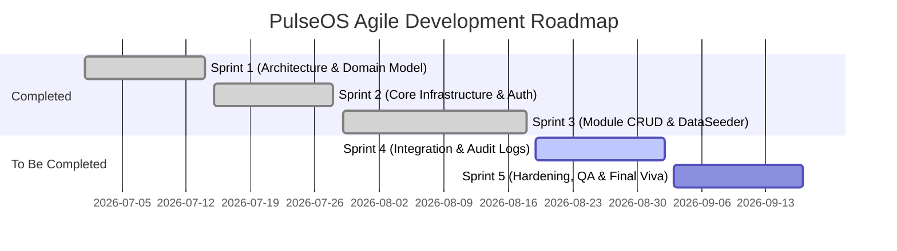
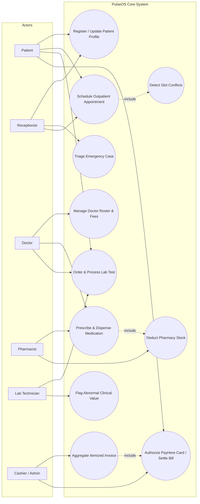
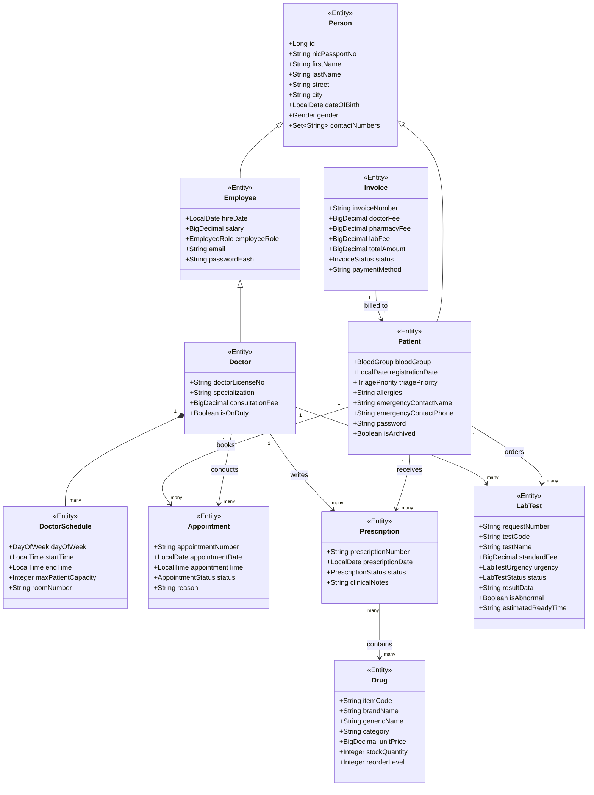
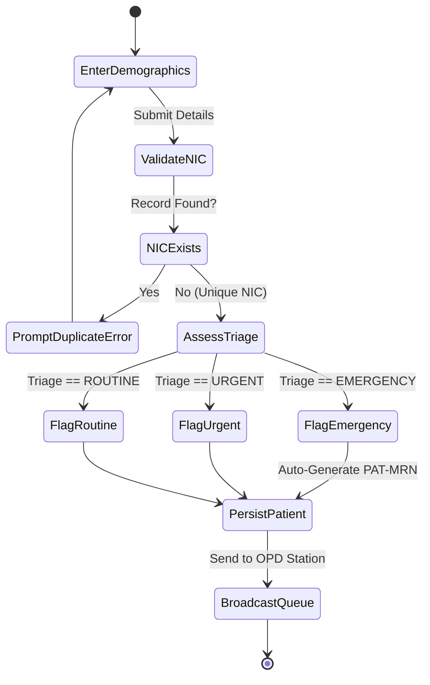
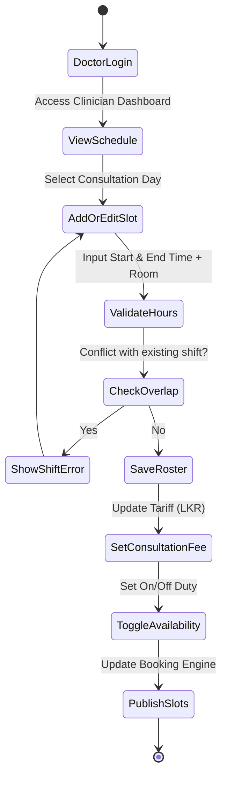
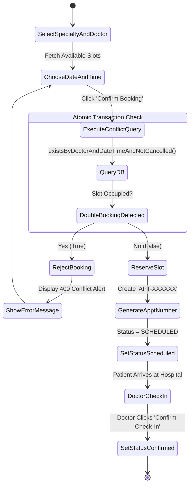
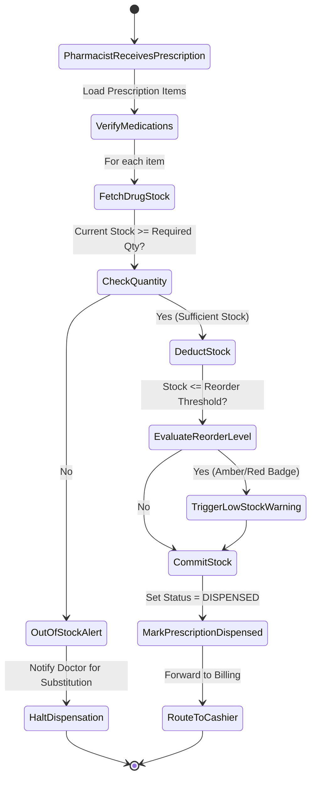
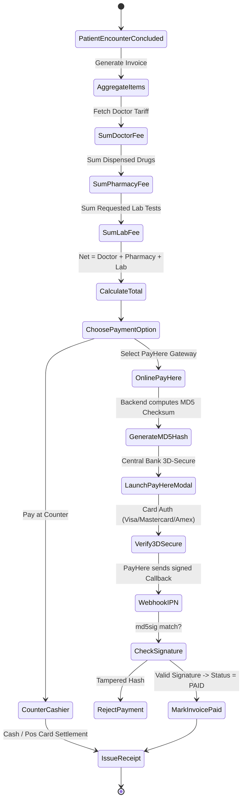
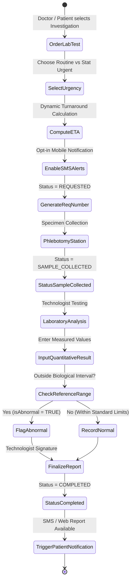

# SE2030 — Software Engineering
## Phase 2: Software Design Document (SDD)
**Academic Year 2026 | Year 2 Semester 1 | Batch 02**
**Group ID: `2026-Y2-S1-KU-60` (Group 60)**

---

### Project Title: PulseOS — Web-Based Hospital Management System
**Module Code**: SE2030 — Software Engineering Project  
**Submission Component**: Phase 2 Progress Presentation & Design Document (Weightage: 30%)  
**Submission Date**: September 15, 2026  

| Student ID | Student Name | Assigned Major Function |
| :--- | :--- | :--- |
| **IT25103992** | **Dhanasinghe K. A. K. H. (Leader)** | **M5: Billing, Itemized Invoicing & PayHere Gateway** |
| **IT25103819** | **Somarathna P. G. D. S.** | **M1: Patient Registration, Demographics & Triage** |
| **IT25103999** | **Rathnayaka R. M. K. L. B.** | **M2: Doctor Profiles, Specialties & Weekly Rostering** |
| **IT25101620** | **Malwatta M.W.C.S** | **M3: Outpatient Appointment Scheduling & Conflict Prevention** |
| **IT25100826** | **Udumullage S.H.U.** | **M4: Pharmacy Inventory, Prescriptions & Stock Deduction** |
| **IT25103363** | **Thilakarathne H.S.K.P.N** | **M6: Pathology Laboratory Investigations & Result Tracker** |

---

## 1. Agile Sprint Summaries

Our team adopted the **Scrum Agile framework** with 2-week sprint cadences managed via GitHub Projects. The development timeline spans Sprints 1 to 3 (completed for 75%+ progress milestone) and Sprints 4 to 5 (planned for final release).

### 1.1 Completed Sprints (Phase 1 & Phase 2)

#### Sprint 1: Requirements Gathering, EER Modeling & UI Foundation (Weeks 4–5)
- **Goal**: Establish the domain model, entity relationship diagrams, architectural seams, and UI design tokens.
- **Key Deliverables**:
  - Comprehensive 27-entity EER diagram featuring Table-Per-Type inheritance for hospital staff and persons.
  - Initialized Maven Spring Boot 3.2 backend (Java 17) and Vite React 19 frontend with Tailwind CSS.
  - Established project repository on GitHub with branch protection rules.

#### Sprint 2: Core Infrastructure, Security & Cross-Cutting Concerns (Weeks 6–7)
- **Goal**: Stand up RESTful service foundations, authentication shells, and database persistence.
- **Key Deliverables**:
  - Configured Spring Security filter chain with role-based routing (`DOCTOR`, `RECEPTIONIST`, `PHARMACIST`, `LAB_TECHNICIAN`, `SYSTEM_ADMIN`).
  - Implemented dual-database profile (`demo` H2 in-memory with TCP Server port 9092 + `mysql` production profile).
  - Built reusable UI component library: modal dialogs, status badges, data tables, and navigation shells.

#### Sprint 3: Major Function CRUD Implementation & Real-Time Engine (Weeks 8–9)
- **Goal**: Achieve 75%+ functionality across all 6 core modules with end-to-end frontend-backend connectivity.
- **Key Deliverables**:
  - **M1 (Dila)**: Patient registry with NIC duplicate checks, emergency triage priority tags, and patient portal self-service.
  - **M2 (Kavinda)**: Doctor specialty profiles, consultation fee settings, and interactive weekly roster management.
  - **M3 (Chanul)**: Calendar-based appointment booking with transactional double-booking conflict prevention.
  - **M4 (Harshika)**: Drug inventory intake, reorder-level alerts, and atomic stock deductions upon prescription dispensing.
  - **M5 (Kesaru)**: Multi-department invoice aggregation and live PayHere Sandbox card checkout with MD5 hashing.
  - **M6 (Nethuli)**: Diagnostic lab test orders, dynamic turnaround time (ETA) calculation, SMS alert toggles, and abnormal result flagging.
  - **DataSeeder**: Automated bootstrapper populating 10 doctors, 13 patients, 23 medications, appointments, and diagnostic records.

### 1.2 Planned Sprints (Leading to Phase 3 Final Submission)

#### Sprint 4: Advanced Audit Logging, Reporting & Patient Notifications (Weeks 11–12)
- **Planned Activities**:
  - SMS gateway integration (Twilio / Dialog Ideamart) for automated appointment reminders and lab ready alerts.
  - PDF clinical receipt and pathology lab report generation using JasperReports / OpenPDF.
  - Automated database backup cron jobs and MySQL replication testing.

#### Sprint 5: System Hardening, Penetration Testing & Final Viva Defense (Weeks 13–14)
- **Planned Activities**:
  - OWASP Top 10 security audit (SQL injection, XSS, CSRF token validation).
  - End-to-end integration test suite execution with zero flaky tests.
  - Final project documentation, user manual generation, and viva rehearsal.

---

## 2. Final Use Case Diagram

The PulseOS Hospital Management System serves six primary actors interacting with specialized workflows across outpatient, clinical, and administrative channels.

---

## 3. High-Level Class Diagram

PulseOS enforces object-oriented domain modeling utilizing inheritance, encapsulation, and relational associations.

---

## 4. Activity Diagrams for the Six Major Functions

### 4.1 Major Function 1: Patient Registration & Emergency Triage (Dila — IT25103819)

### 4.2 Major Function 2: Doctor Schedule & Weekly Rostering (Kavinda — IT25103999)

### 4.3 Major Function 3: Appointment Booking & Conflict Prevention (Chanul — IT25101620)

### 4.4 Major Function 4: Pharmacy Inventory & Stock Deduction (Harshika — IT25100826)

### 4.5 Major Function 5: Multi-Item Billing & PayHere Gateway (Kesaru — IT25103992)

### 4.6 Major Function 6: Laboratory Investigations & Lifecycle (Nethuli — IT25103363)

---

## 5. Ethical Considerations & Compliance

### 5.1 Patient Data Privacy & Confidentiality (GDPR / HIPAA Standards)
- **Data Minimization**: Only authenticated clinical personnel have access to medical charts. Receptionists can only access demographic records, while laboratory technologists and pharmacists access only their respective diagnostic and prescription scopes.
- **Credential Protection**: Passwords are never stored in plaintext. In production, BCrypt cryptographic hashing with standard salting factors prevents credential theft.

### 5.2 Informed User Consent & Clinical Transparency
- Patients retain complete visibility over their outpatient records through the dedicated Patient Portal.
- When requesting diagnostic laboratory tests or scheduling specimen intake, patients explicitly consent to collection dates and receive itemized fee breakdowns prior to checkout.

### 5.3 Financial Transparency & Payment Security (Central Bank of Sri Lanka)
- **Anti-Tamper Cryptography**: PayHere online payments utilize one-way MD5 cryptographic hashes combining merchant secret tokens, order IDs, and exact transaction amounts, preventing client-side price manipulation.
- **Server-to-Server IPN Validation**: Invoices transition to `PAID` exclusively when signed server-to-server IPN webhooks verify against the cryptographic signature.

### 5.4 Digital Accessibility & Human-Centered Clinical Ergonomics (WCAG 2.1)
- Color contrast ratios in the interface adhere to WCAG AAA standards (crisp slate ground `#F8FAFC`, deep ink `#0F172A`, clinical teal `#0D9488`, and high-visibility urgent coral `#F43F5E`).
- Medical alerts use dual indicators (color badges + Lucide clinical icons) to ensure accessibility for color-blind practitioners.

---
**Prepared and verified by Group 60 (`2026-Y2-S1-KU-60`) for SLIIT SE2030 Phase 2 Progress Evaluation.**
