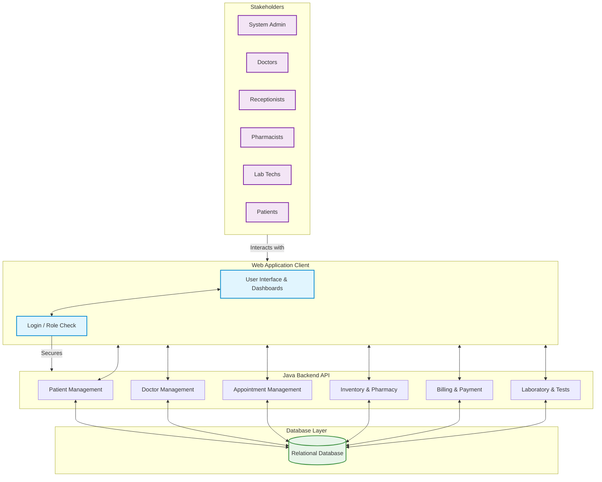

# Diagram Generation Prompt

If you need to generate the System Overview Diagram quickly, you can use **Mermaid JS**. Go to [mermaid.live](https://mermaid.live) and paste the following code to instantly generate a professional diagram that you can download as a PNG for your slides and report.

